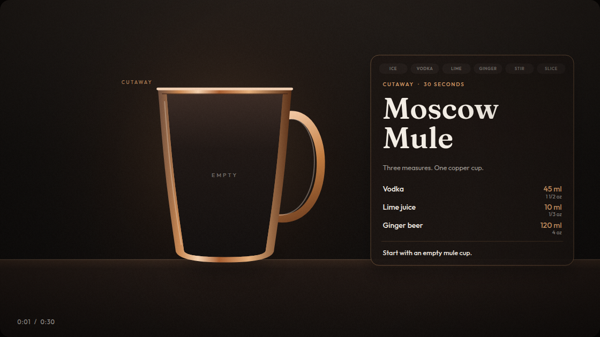
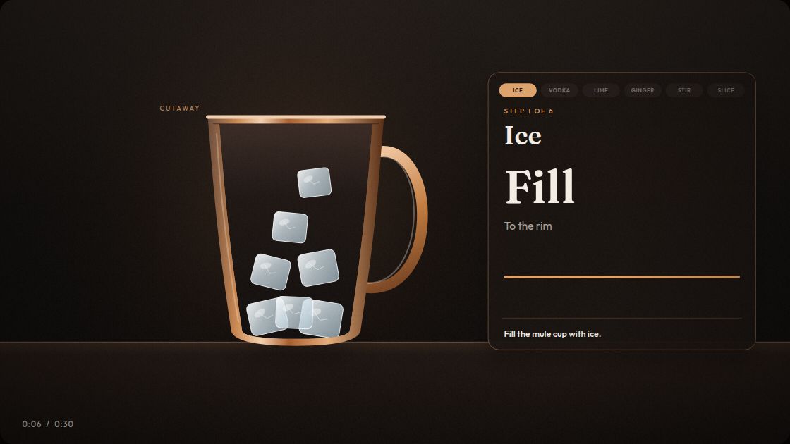
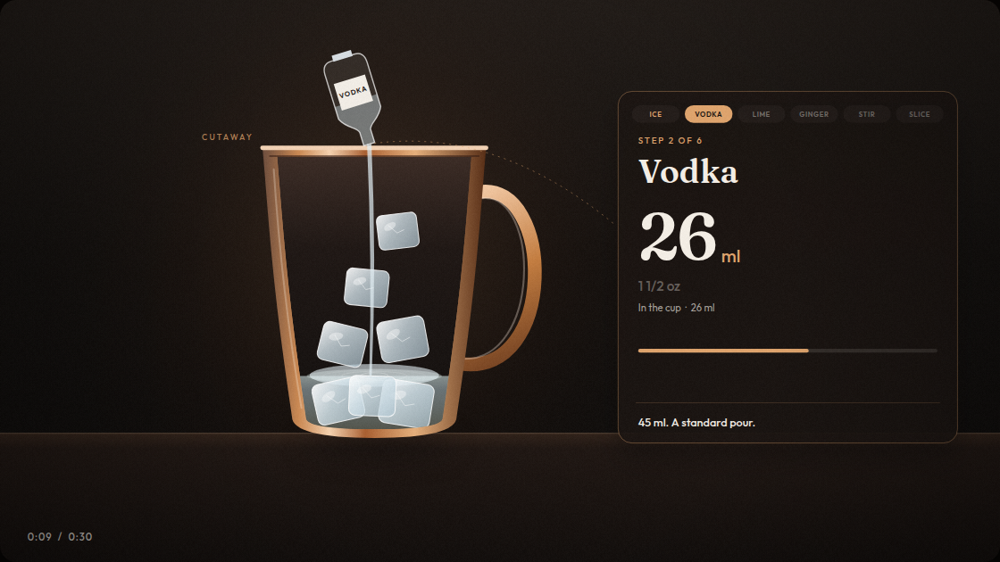
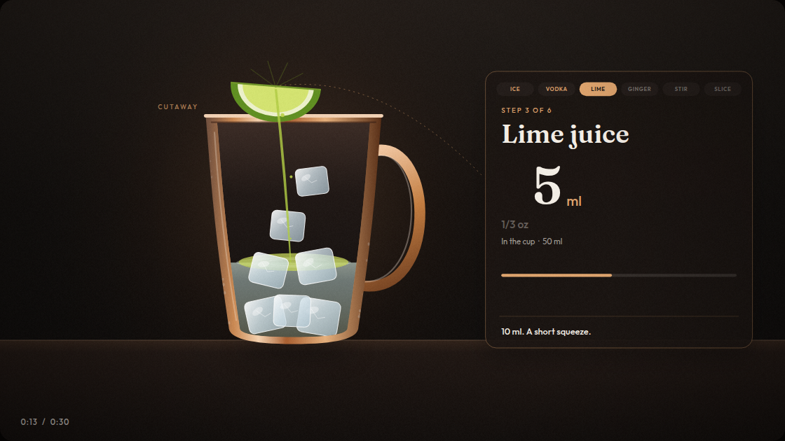
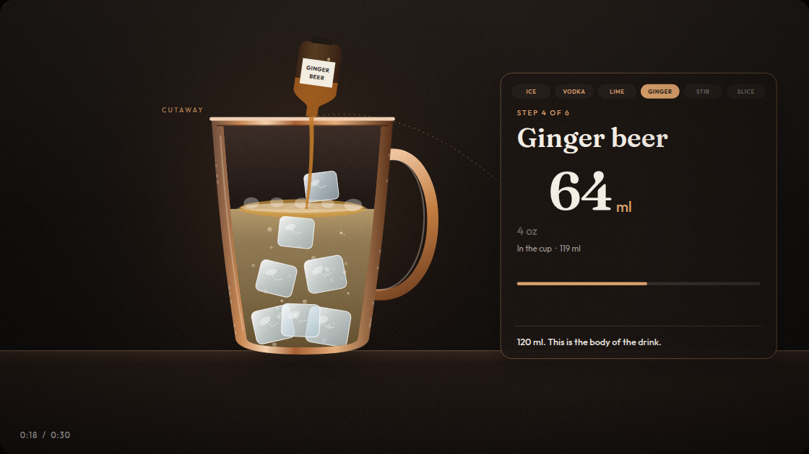
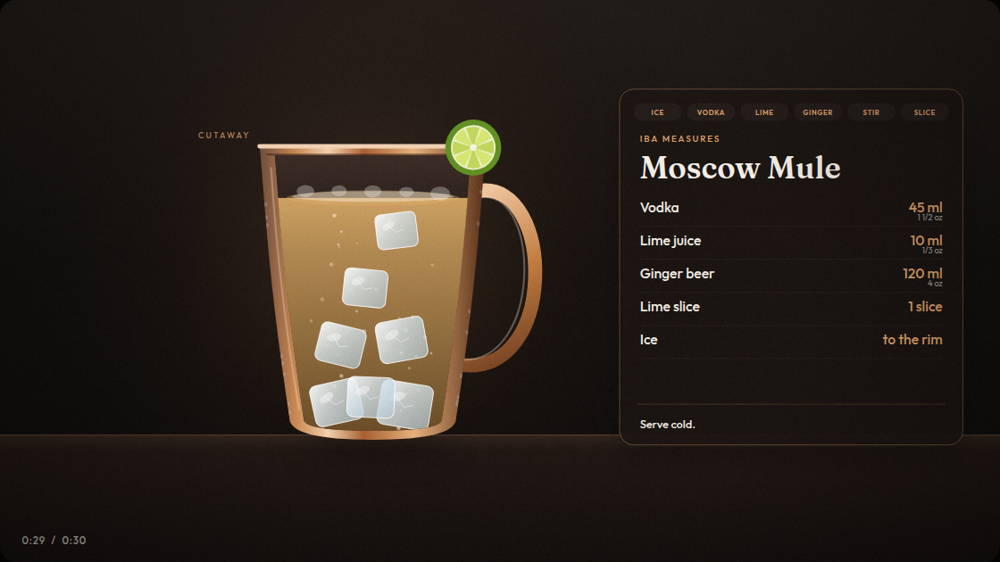

# Moscow Mule, a 30-second build

Thirty-second canvas explainer that builds an IBA Moscow Mule from an empty mule cup to the finished drink.

## The build

Empty mule cup, before anything goes in.



Ice in the cup.



Vodka, mid-pour. The counter is climbing to 45 ml.



Fresh lime juice, mid-squeeze. The full measure is 10 ml.



Ginger beer, mid-pour. The full measure is 120 ml.



Finished drink, with the IBA measures on the card.



## Run

```bash
npm install
npm run dev
```

The player is at `http://127.0.0.1:47321`. Space plays and pauses. Arrow keys step one second. Save WebM records a realtime pass of the canvas.

`?t=12.5` opens on that second. `?play=1` starts playback.

## What the picture shows

| Time | Step | On-screen measure |
| --- | --- | --- |
| 0:00 | Empty mule cup | Cutaway |
| 0:02 | Ice | Fill the cup |
| 0:07 | Vodka | 45 ml, 1 1/2 oz |
| 0:12 | Fresh lime juice | 10 ml, 1/3 oz |
| 0:15 | Ginger beer | 120 ml, 4 oz |
| 0:22 | Stir | Once, gently |
| 0:25 | Lime slice | 1 slice |
| 0:27 | Finished drink | IBA measures |

Measures follow the [IBA Moscow Mule](https://iba-world.com/iba-cocktail/moscow-mule/): 45 ml vodka, 10 ml fresh lime juice, 120 ml ginger beer, lime slice. The IBA method combines vodka and ginger beer, then lime. The animation pours ginger beer last so the fill reads. Ounce labels use a 30 ml bar ounce. Ice fills the mule cup. It is not a separate IBA measure.

## Type

Fraunces and Outfit are bundled as WOFF2 subsets under the SIL Open Font License. License texts are in `public/fonts/`.
